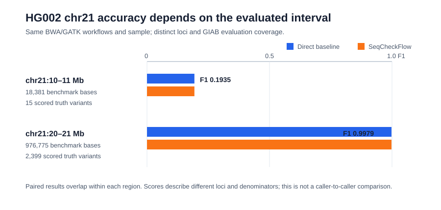

# Pipeline Analysis Report

## Scope and current evidence

This report covers two separate analyses. The HG002 benchmarks compare
direct command-line tools with SeqCheckFlow wrappers across two separate
GRCh38 chr21 intervals; the earlier chr20 run is retained as historical
context. The RNA-seq section summarizes the completed raw-read reanalysis of GEO GSE52778. These are project examples, not a combined study.

The chr21 figures and tables are updated from the local RTG vcfeval reports
for `results/HG002_chr21_comparison/` and
`results/HG002_chr21_20000000_21000000_comparison/`. A separate historical
chr20 summary and its figures are retained below; its raw generated result
directory is not available in this checkout.
The RNA-seq figures are from the eight-library run described below. Result
directories are local generated artifacts and are ignored by Git.

## Executive summary

- In both chr21 intervals, the direct-tool and SeqCheckFlow callsets had
  identical non-header VCF records (7,274 in the low-coverage interval and
  2,706 in the high-coverage interval), supporting implementation parity.
- In chr21:10,000,000–11,000,000, both callsets scored F1 = 0.1935 (3 TP,
  13 FP, 12 FN), but the benchmark BED covers only 18,381 bp (1.84%) and only
  15 truth variants were scored. Most calls were outside the BED.
- In the separate chr21:20,000,000–21,000,000 interval, both callsets scored
  F1 = 0.9979 (2,392 TP, 3 FP, 7 FN) across 976,775 benchmark bases and 2,399
  scored truth variants. The exact paired outputs and strong result show that
  the first chr21 score is region-specific evidence, not evidence that the
  entire workflow is broadly inaccurate.
- One measured wrapped run took 17.0 seconds longer (+1.49%) and had 11.1 MiB
  more peak sampled process-tree RSS than the direct baseline. A single run
  cannot establish a performance difference.
- In the separate airway RNA-seq reanalysis, no genes passed the
  Benjamini-Hochberg adjusted `p < 0.05` threshold for the dexamethasone term
  after including donor cell line in the model. With four donors, this does
  not demonstrate absence of a biological effect.

## Earlier HG002 chr20 regional benchmark (historical result)

The project previously ran the same direct-tool-versus-wrapper comparison on
GRCh38 `chr20:10000000-11000000`. This is a separate regional run from the
current chr21 benchmark below. The historical report recorded the following
results; its generated `results/HG002_chr20_comparison/` files are not present
in this checkout, so these values are preserved from the prior report rather
than re-derived from the raw comparison artifacts.

| Measure | Direct baseline | SeqCheckFlow wrappers | Historical observation |
| --- | ---: | ---: | --- |
| Wall time | 327.71 s | 302.35 s | One measurement was 25.36 s (7.7%) faster with wrappers. |
| Peak sampled process-tree RSS | 584.5 MiB | 561.6 MiB | Wrapper run was 22.9 MiB lower in this measurement. |
| Output size | 603,418,500 bytes | 603,418,541 bytes | 41-byte difference. |
| Truth-set results | 1,582 TP, 6 FP, 6 FN | 1,582 TP, 6 FP, 6 FN | Precision, recall, and F1 were each 0.9962 for both. |

These plots preserve what was reported for the earlier run. The chr20 and chr21
metrics should not be interpreted as a change in accuracy: they cover different
regions, with different truth variants and confident bases. The single timing
and memory measurements also do not establish a general performance advantage.

## HG002 chr21 regional benchmark

The run used two threads and the pinned container tools (BWA 0.7.17, samtools
1.20, GATK 4.5.0.0, and RTG Tools 3.12.1). The same inputs, tool versions, and
arguments were used for each implementation.

### Truth-set results

| Measure | Direct baseline | SeqCheckFlow wrappers | What it means |
| --- | ---: | ---: | --- |
| VCF variant records | 7,274 | 7,274 | Non-header variant records are identical between the two VCFs. |
| Truth variants in evaluated BED | 15 | 15 | The regional truth VCF has 16 records; one is outside the confident intervals. |
| True positives | 3 | 3 | Truth variants matched by calls. |
| False positives | 13 | 13 | Calls inside the evaluated bases that did not match truth. |
| False negatives | 12 | 12 | Truth variants inside the evaluated bases that were missed. |
| Precision | 0.1875 | 0.1875 | 3 of 16 calls inside the evaluation intervals were true positives. |
| Sensitivity / recall | 0.2000 | 0.2000 | 3 of 15 evaluated truth-positive outcomes were recovered. |
| F1 | 0.1935 | 0.1935 | Harmonic mean of precision and sensitivity. |

**Why this graph:** paired bars put the two implementations on the same
0–100% scale, so any difference is visible without truncating the axis. The
bars overlap because the outputs match. Their low values also make clear that
parity is not the same as good accuracy. The table supplies the small integer
denominators that a percentage-only chart would hide.

The HG002 confident BED has 29 disjoint intervals totaling 18,381 bp, only
1.84% of the requested 1 Mb. RTG reports that 7,257 of 7,273 evaluated call
records fell outside those confident intervals; those calls are unscored, not
false positives. Within the scored bases, 15 truth variants and 16 calls are
represented in the TP/FP/FN counts; these small denominators make each metric
sensitive to a few calls. The result says the wrappers reproduce the direct pipeline exactly in this
run, while the calls disagree with truth at many of the few scored loci. The
small BED coverage explains why this result cannot represent the whole 1 Mb
window or chromosome; it does not, by itself, explain the observed errors. The
current data do not establish whether those errors stem from local sequence or
read-mapping context, read coverage, variant representation, or another input
or workflow issue. Establishing that requires inspecting the FP/FN loci against
the reads and alignment metrics. The high-coverage chr21 rerun below shows that
the same configured workflow performs strongly in a different interval.

### Runtime, memory, and stage profile

| Measure | Direct baseline | SeqCheckFlow wrappers | Difference (wrapper minus baseline) |
| --- | ---: | ---: | ---: |
| Total workflow wall time | 1,140.59 s (19m 0.6s) | 1,157.60 s (19m 17.6s) | +17.00 s (+1.49%) |
| Peak sampled process-tree RSS | 592.7 MiB | 603.8 MiB | +11.1 MiB |
| Total output bytes | 1,161,706,207 | 1,161,706,424 | +217 bytes |

**Why this graph:** total wall time and peak sampled RSS answer two practical
questions for a reproducible run: how long did it take, and how much memory
did its peak process tree use? Both panels use a zero-based scale and show the
small observed difference directly. Output size is reported in the table
because the 217-byte difference is too small to read meaningfully on the same
visual scale as gigabyte-scale workflow outputs.

The largest baseline stages were GATK HaplotypeCaller (489.37 s; 42.9% of
workflow time), GATK BaseRecalibrator (333.34 s; 29.2%), and BWA-MEM (85.60 s;
7.5%). These stages explain most of the runtime and point to caller/recalibration
work as the main targets if runtime needs improvement. Stage times and sampled
RSS can vary with CPU scheduling, caches, and concurrent load. The baseline ran
first, then the wrapper; this was one sequential measurement, not a randomized
or repeated performance study. RSS was sampled every 50 ms and summed across
processes, which can double-count shared memory.

The records match even though compressed VCF file hashes and byte sizes differ.
Headers and serialization details can differ; the comparison above checks the
actual non-header variant records. Matching output supports wrapper parity,
not a claim that either calling workflow is clinically validated or generally
accurate.

## HG002 chr21 high-coverage regional rerun

To determine whether the low score in the earlier chr21 interval reflected the
whole workflow, we ran the same two-thread BWA 0.7.17, samtools 1.20, and GATK
4.5.0.0 baseline and SeqCheckFlow-wrapper pipelines on
`chr21:20000000-21000000`. The GIAB confident BED covers 976,775 of the requested
1,000,000 bases (97.68%) across 132 intervals. RTG scored 2,399 truth variants
in those bases.

| Measure | Direct baseline | SeqCheckFlow wrappers |
| --- | ---: | ---: |
| Non-header VCF records | 2,706 | 2,706 |
| Exact non-header record parity | Yes | Yes |
| True positives | 2,392 | 2,392 |
| False positives | 3 | 3 |
| False negatives | 7 | 7 |
| Precision | 0.9987 | 0.9987 |
| Sensitivity / recall | 0.9971 | 0.9971 |
| F1 | 0.9979 | 0.9979 |
| Wall time (one run) | 674.26 s | 759.01 s |

**Why this graph:** the paired bars show that the implementations agree within
each interval, while the annotations expose how different the evaluation
denominators are. The large F1 change between chr21 windows is not evidence of
a software change or a caller-to-caller comparison: it reflects two distinct
sets of genomic loci, with different benchmark coverage and truth variants.
The first interval has too few scored variants for a stable broad conclusion;
the second is much more informative and shows strong accuracy for this sample,
reference, tool configuration, and interval. The one-run timing difference is
descriptive only.

This result supports that the standard BWA/GATK workflow can achieve high
accuracy in a well-covered chr21 region and that the wrappers reproduce the
direct commands there. It does not establish accuracy across the whole
chromosome or genome. For that, aggregate counts over multiple well-covered
regions (or a whole-GIAB-confidence run), separate SNVs from indels, and inspect
representative FP/FN loci as recommended in benchmarking guidance.

## What explains the regional results—and what is still unknown

The two chr21 runs used the same sample, reference assembly, pinned tool
versions, two-thread setting, and direct-versus-wrapper design. In each window,
the baseline and wrapper VCF records match exactly. The large accuracy
difference is therefore a difference between the genomic intervals and their
truth-scored loci, not a difference between the two implementations in these
runs. The `chr21:10-11 Mb` BED covers 1.84% of the window and yields just 15
scored truth variants; the `chr21:20-21 Mb` BED covers 97.68% and yields 2,399.
The first denominator is too small to support a stable general estimate. Its
low score is a real result for the scored loci, but it is not representative of
the full window because nearly all bases and calls are outside the evaluation
mask. Outside-mask calls are unscored, not false positives.

Mask size is not a causal explanation for individual mismatches. We have not
yet diagnosed the 13 FP and 12 FN in the first interval at read level. To
explain those errors, inspect each discordant locus in the truth/call VCFs and
aligned BAMs, recording depth, mapping quality, read support, local sequence
context, and whether a nearby complex variant affects representation. A
region-specific diagnosis should distinguish these observed facts from any
hypothesized mechanism.

### What a run should establish

A result is interpretable when it records and checks all of the following:

- **Input identity:** sample and paired-read identity; FASTQ validation; read
  counts and quality; reference assembly and contig names; checksums for reads,
  reference, known-sites, truth VCF, BED, and RTG SDF.
- **Resource compatibility:** known-sites are a BQSR resource, while the truth
  VCF and benchmark BED are evaluation resources. All must match the same
  assembly and contig naming. The RTG SDF must be built from the exact reference
  FASTA used by BWA and GATK.
- **Coordinate agreement:** record that command-line intervals are 1-based
  inclusive while BED uses 0-based half-open coordinates. Report the BED
  overlap in bases and the number of truth variants and calls actually scored
  before interpreting precision, recall, or F1.
- **Execution evidence:** pinned container and tool versions, parameters,
  stage exit status and logs, distinct output directory, per-stage outputs, and
  final callset record parity for the direct and wrapped paths.
- **Accuracy evidence:** truth-based TP/FP/FN counts and metrics across
  multiple well-covered regions, preferably with SNVs and indels separated;
  inspect representative errors. A single small interval is a diagnostic,
  not a whole-genome accuracy estimate.
- **Performance evidence:** repeated runs with controlled order and comparable
  resource conditions. One timing or sampled-memory measurement is descriptive,
  not a performance conclusion.

Wrapper parity and pipeline accuracy answer separate questions. Exact matching
between direct and wrapped callsets checks that SeqCheckFlow invokes the same
workflow. RTG comparison with truth estimates accuracy only for the benchmark
loci selected by the BED. Both are needed to make the kinds of claims made in
this report.

## Raw-read RNA-seq differential-expression analysis

The airway example uses eight paired-end libraries from GEO GSE52778: four
donor cell lines, each untreated and dexamethasone treated. The pipeline runs
fastp, Salmon selective-alignment quantification, tximport, and DESeq2. DESeq2
uses `~ cell + dex`, with untreated as the treatment reference; this estimates
the dexamethasone association while accounting for donor cell line. Salmon
mapping rates were 92.3–93.9% across the libraries.

No gene passed the Benjamini-Hochberg adjusted `p < 0.05` threshold for the
dexamethasone coefficient. This is a failure to detect significant genes under
this model and sample size, not proof of no effect. The analysis has only four
biological donors, and the observed sample structure shows that the treatment
contrast is not a simple dominant axis shared identically across donors.

### What each RNA-seq stage establishes

| Stage | Purpose | Output / evidence to check |
| --- | --- | --- |
| ENA download | Fetch paired FASTQs for the eight run accessions in the sample sheet and verify gzip integrity. | Sample/run mapping and both read mates; a correct download does not validate sample labels or biological design. |
| fastp | Trim adapters and low-quality sequence and produce per-library QC summaries. | Trimmed FASTQs and HTML/JSON reports; check read retention, quality, and adapter content before quantification. |
| Salmon index | Build a transcript index from Ensembl 112 GRCh38 cDNA and derive transcript-to-gene mapping from the matching GTF. | Index plus `tx2gene.tsv`; keep the transcript reference and annotation release paired. |
| Salmon quantification | Selectively align reads to transcripts, validate mappings, and estimate abundance with sequence/GC bias correction. | `quant.sf` plus mapping/quantification metadata; mapping rate is a quantification QC measure, not differential-expression evidence. |
| MultiQC | Combine fastp and Salmon auxiliary summaries across samples. | A single HTML overview for sample-level QC; it does not test the treatment effect. |
| tximport / DESeq2 | Import transcript estimates at gene level, filter genes with total counts below 10, then fit `~ cell + dex` and estimate treated versus untreated while accounting for donor cell line. | Gene table with `baseMean`, `log2FoldChange`, standard error/statistic, raw `pvalue`, and BH-adjusted `padj`; summary and R session information. |

The samplesheet pairs each donor cell line across untreated and treated
conditions. With only four biological donors, estimates have limited precision.
The BH-adjusted threshold controls multiple testing at the analysis level; a
large fold-change estimate alone is not enough evidence when its adjusted
p-value is not significant. The PCA, MA, and volcano plots below each answer a
different descriptive question and complement the model rather than replace it.

### Sample structure: PCA

**Why this graph:** PCA is an unsupervised overview of the largest expression
variation. It is useful for checking sample relationships, possible outliers,
and whether treatment is an obvious source of global variation before reading
gene-level tests. PC1 explains 52% and PC2 37% (89% together). The treated and
untreated samples do not form two clean, uniformly separated groups in these
axes; within-donor positions also vary. PCA is descriptive and does not test
the dexamethasone effect, which is why donor is included in the DESeq2 model.

### Differential expression: MA plot

**Why this graph:** an MA plot places average normalized expression on the
x-axis and estimated log2 fold change on the y-axis. It reveals whether
estimated changes depend on abundance and shows the expected wider spread for
low-count genes. It is useful for diagnosing effect-size patterns across the
expression range; it does not by itself show statistical evidence. In this
run, the cloud is centered near zero, with broad low-count estimates and no
genes highlighted as significant at the chosen adjusted-p threshold.

### Differential expression: volcano plot

**Why this graph:** the volcano plot combines estimated effect size (log2 fold
change) and multiple-testing-adjusted evidence (`-log10(padj)`). The horizontal
line marks adjusted `p = 0.05`; no points cross it. Several genes have large
estimated fold changes but remain far below the evidence threshold, showing
why effect magnitude alone is not enough to call differential expression.
The volcano plot complements the MA plot: it emphasizes evidence versus
effect size, while the MA plot emphasizes effect size versus abundance.

### Read and quantification quality

The [MultiQC report](docs/reports/airway-multiqc.html) brings per-library
fastp read-quality and Salmon mapping/quantification summaries into one place.
It is included as a workflow-quality check, not as evidence for differential
expression.

## Single-file QC: measures and limits

The CLI validates and summarizes individual files; it does not run the larger
workflows above automatically. The JSON and text reports answer structural and
basic QC questions, not biological interpretation.

| Input | What the report measures | What it does not establish |
| --- | --- | --- |
| FASTA | Record count, total bases, min/max/mean sequence length, and GC content. | Species identity, assembly correctness, contamination, or sequence function. |
| FASTQ | Read count, length/base-quality distributions, mean quality, GC, ambiguous bases, and reads below the mean Phred+33 cutoff. | Adapter removal, mate pairing across two files, mapping, or locus-level coverage. |
| VCF / VCF.GZ | Record and contig counts, SNP/indel/other allele counts, filter categories, QUAL mean, sample names, and genotype counts. | Reference compatibility, truth-set accuracy, functional effect, or clinical significance. |
| BAM / CRAM | Samtools integrity check, flagstat, stats, and coverage summaries; CRAM can be decoded with a supplied reference. | Variant calls, claimed sample identity, or accuracy without suitable truth evaluation. |

A structurally valid input may still be unsuitable for a particular biological
question. Keep the assembly, sample metadata, and a matching reference for CRAM
with its reports.

## Limits and next steps

The HG002 examples are single-sample, two-thread regional parity checks. The
10–11 Mb chr21 interval has only 1.84% confident coverage and is too narrow to
generalize; the 20–21 Mb run is strong evidence for that interval, not a
chromosome-wide estimate. The RNA-seq result is an exploratory reanalysis
of one public study with four donors; no adjusted-significant genes does not
prove no treatment effect. Neither analysis supports clinical use or broad
biological claims.

For a stronger HG002 accuracy evaluation, choose a region with broad GIAB
confident coverage, inspect truth/call discordances, and repeat on multiple
regions and samples. For performance claims, repeat both workflows under
controlled run order and report variability. For RNA-seq, additional
independent donors would improve precision and power to estimate treatment
effects across biological variability.
