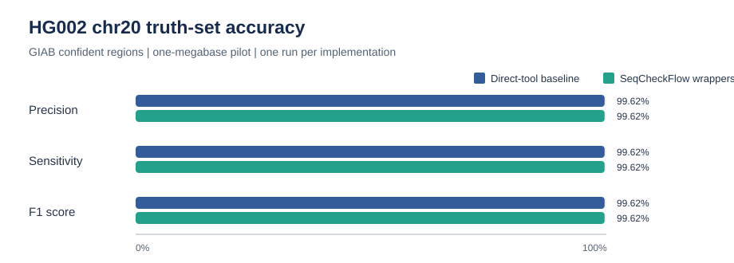
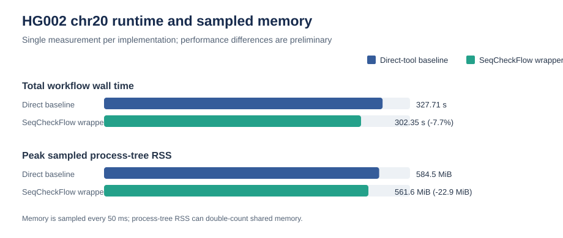
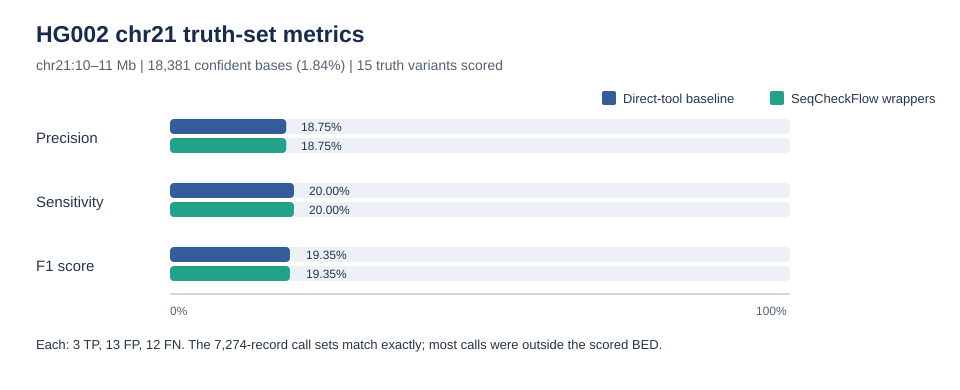
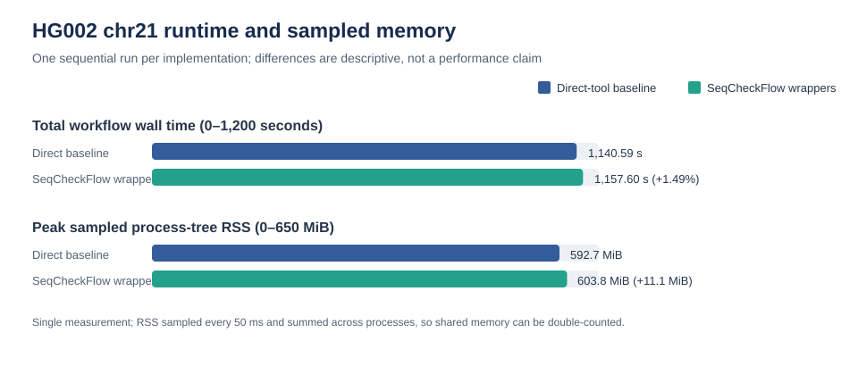

# Pipeline Analysis Report

## Scope and current evidence

This report covers two separate analyses. The current HG002 benchmark compares
direct command-line tools with SeqCheckFlow wrappers on GRCh38
`chr21:10000000-11000000`. The RNA-seq section summarizes the completed raw-read
reanalysis of GEO GSE52778. These are project examples, not a combined study.

The current chr21 figures and tables are updated from
`results/HG002_chr21_comparison/comparison.json` and its RTG vcfeval reports.
A separate historical chr20 summary and its figures are retained below; its
raw generated result directory is not available in this checkout.
The RNA-seq figures are from the eight-library run described below. Result
directories are local generated artifacts and are ignored by Git.

## Executive summary

- The direct-tool and SeqCheckFlow runs generated exactly matching variant
  records: 7,274 records in each VCF, with identical non-header records.
  This supports implementation parity for this run.
- RTG vcfeval reported low accuracy for both call sets in the evaluated
  confident bases: 3 true positives, 13 false positives, and 12 false
  negatives (F1 = 0.1935). The benchmark interval is 1 Mb, but the GIAB
  confident-region BED covers only 18,381 bp (1.84%); 15 of the 16 truth VCF
  records overlap those scored bases. Most calls were outside the BED and were
  not scored. Treat this as a narrow diagnostic result, not a representative
  chromosome-wide accuracy estimate.
- One measured wrapped run took 17.0 seconds longer (+1.49%) and had 11.1 MiB
  more peak sampled process-tree RSS than the direct baseline. A single run
  cannot establish a performance difference.
- In the separate airway RNA-seq reanalysis, no genes passed the
  Benjamini-Hochberg adjusted `p < 0.05` threshold for the dexamethasone term
  after including donor cell line in the model. With four donors, this does
  not demonstrate absence of a biological effect.

## Earlier HG002 chr20 regional benchmark (historical result)

The project previously ran the same direct-tool-versus-wrapper comparison on
GRCh38 `chr20:10000000-11000000`. This is a separate regional run from the
current chr21 benchmark below. The historical report recorded the following
results; its generated `results/HG002_chr20_comparison/` files are not present
in this checkout, so these values are preserved from the prior report rather
than re-derived from the raw comparison artifacts.

| Measure | Direct baseline | SeqCheckFlow wrappers | Historical observation |
| --- | ---: | ---: | --- |
| Wall time | 327.71 s | 302.35 s | One measurement was 25.36 s (7.7%) faster with wrappers. |
| Peak sampled process-tree RSS | 584.5 MiB | 561.6 MiB | Wrapper run was 22.9 MiB lower in this measurement. |
| Output size | 603,418,500 bytes | 603,418,541 bytes | 41-byte difference. |
| Truth-set results | 1,582 TP, 6 FP, 6 FN | 1,582 TP, 6 FP, 6 FN | Precision, recall, and F1 were each 0.9962 for both. |

These plots preserve what was reported for the earlier run. The chr20 and chr21
metrics should not be interpreted as a change in accuracy: they cover different
regions, with different truth variants and confident bases. The single timing
and memory measurements also do not establish a general performance advantage.

## HG002 chr21 regional benchmark

The run used two threads and the pinned container tools (BWA 0.7.17, samtools
1.20, GATK 4.5.0.0, and RTG Tools 3.12.1). The same inputs, tool versions, and
arguments were used for each implementation.

### Truth-set results

| Measure | Direct baseline | SeqCheckFlow wrappers | What it means |
| --- | ---: | ---: | --- |
| VCF variant records | 7,274 | 7,274 | Non-header variant records are identical between the two VCFs. |
| Truth variants in evaluated BED | 15 | 15 | The regional truth VCF has 16 records; one is outside the confident intervals. |
| True positives | 3 | 3 | Truth variants matched by calls. |
| False positives | 13 | 13 | Calls inside the evaluated bases that did not match truth. |
| False negatives | 12 | 12 | Truth variants inside the evaluated bases that were missed. |
| Precision | 0.1875 | 0.1875 | 3 of 16 calls inside the evaluation intervals were true positives. |
| Sensitivity / recall | 0.2000 | 0.2000 | 3 of 15 evaluated truth-positive outcomes were recovered. |
| F1 | 0.1935 | 0.1935 | Harmonic mean of precision and sensitivity. |

**Why this graph:** paired bars put the two implementations on the same
0–100% scale, so any difference is visible without truncating the axis. The
bars overlap because the outputs match. Their low values also make clear that
parity is not the same as good accuracy. The table supplies the small integer
denominators that a percentage-only chart would hide.

The HG002 confident BED has 29 disjoint intervals totaling 18,381 bp, only
1.84% of the requested 1 Mb. RTG reports that 7,257 of 7,273 evaluated call
records fell outside those confident intervals; those calls are unscored, not
false positives. Within the scored bases, 15 truth variants and 16 calls are
represented in the TP/FP/FN counts; these small denominators make each metric
sensitive to a few calls. The result
therefore says two things: the wrappers reproduce the direct pipeline exactly
here, and both call sets perform poorly in the small portion where accuracy
could be assessed. It does not identify the cause of the misses or extra
calls. A follow-up should select a region with substantially more GIAB
confident coverage, inspect the discordant loci and read evidence, and then
repeat across independent regions before drawing a broader accuracy
conclusion.

### Runtime, memory, and stage profile

| Measure | Direct baseline | SeqCheckFlow wrappers | Difference (wrapper minus baseline) |
| --- | ---: | ---: | ---: |
| Total workflow wall time | 1,140.59 s (19m 0.6s) | 1,157.60 s (19m 17.6s) | +17.00 s (+1.49%) |
| Peak sampled process-tree RSS | 592.7 MiB | 603.8 MiB | +11.1 MiB |
| Total output bytes | 1,161,706,207 | 1,161,706,424 | +217 bytes |

**Why this graph:** total wall time and peak sampled RSS answer two practical
questions for a reproducible run: how long did it take, and how much memory
did its peak process tree use? Both panels use a zero-based scale and show the
small observed difference directly. Output size is reported in the table
because the 217-byte difference is too small to read meaningfully on the same
visual scale as gigabyte-scale workflow outputs.

The largest baseline stages were GATK HaplotypeCaller (489.37 s; 42.9% of
workflow time), GATK BaseRecalibrator (333.34 s; 29.2%), and BWA-MEM (85.60 s;
7.5%). These stages explain most of the runtime and point to caller/recalibration
work as the main targets if runtime needs improvement. Stage times and sampled
RSS can vary with CPU scheduling, caches, and concurrent load. The baseline ran
first, then the wrapper; this was one sequential measurement, not a randomized
or repeated performance study. RSS was sampled every 50 ms and summed across
processes, which can double-count shared memory.

The records match even though compressed VCF file hashes and byte sizes differ.
Headers and serialization details can differ; the comparison above checks the
actual non-header variant records. Matching output supports wrapper parity,
not a claim that either calling workflow is clinically validated or generally
accurate.

## Raw-read RNA-seq differential-expression analysis

The airway example uses eight paired-end libraries from GEO GSE52778: four
donor cell lines, each untreated and dexamethasone treated. The pipeline runs
fastp, Salmon selective-alignment quantification, tximport, and DESeq2. DESeq2
uses `~ cell + dex`, with untreated as the treatment reference; this estimates
the dexamethasone association while accounting for donor cell line. Salmon
mapping rates were 92.3–93.9% across the libraries.

No gene passed the Benjamini-Hochberg adjusted `p < 0.05` threshold for the
dexamethasone coefficient. This is a failure to detect significant genes under
this model and sample size, not proof of no effect. The analysis has only four
biological donors, and the observed sample structure shows that the treatment
contrast is not a simple dominant axis shared identically across donors.

### Sample structure: PCA

**Why this graph:** PCA is an unsupervised overview of the largest expression
variation. It is useful for checking sample relationships, possible outliers,
and whether treatment is an obvious source of global variation before reading
gene-level tests. PC1 explains 52% and PC2 37% (89% together). The treated and
untreated samples do not form two clean, uniformly separated groups in these
axes; within-donor positions also vary. PCA is descriptive and does not test
the dexamethasone effect, which is why donor is included in the DESeq2 model.

### Differential expression: MA plot

**Why this graph:** an MA plot places average normalized expression on the
x-axis and estimated log2 fold change on the y-axis. It reveals whether
estimated changes depend on abundance and shows the expected wider spread for
low-count genes. It is useful for diagnosing effect-size patterns across the
expression range; it does not by itself show statistical evidence. In this
run, the cloud is centered near zero, with broad low-count estimates and no
genes highlighted as significant at the chosen adjusted-p threshold.

### Differential expression: volcano plot

**Why this graph:** the volcano plot combines estimated effect size (log2 fold
change) and multiple-testing-adjusted evidence (`-log10(padj)`). The horizontal
line marks adjusted `p = 0.05`; no points cross it. Several genes have large
estimated fold changes but remain far below the evidence threshold, showing
why effect magnitude alone is not enough to call differential expression.
The volcano plot complements the MA plot: it emphasizes evidence versus
effect size, while the MA plot emphasizes effect size versus abundance.

### Read and quantification quality

The [MultiQC report](docs/reports/airway-multiqc.html) brings per-library
fastp read-quality and Salmon mapping/quantification summaries into one place.
It is included as a workflow-quality check, not as evidence for differential
expression.

## Limits and next steps

The HG002 run is a single-sample, single-region, two-thread parity check. Its
confident bases cover only 1.84% of the requested interval, so its truth metrics
are too narrow to generalize. The RNA-seq result is an exploratory reanalysis
of one public study with four donors; no adjusted-significant genes does not
prove no treatment effect. Neither analysis supports clinical use or broad
biological claims.

For a stronger HG002 accuracy evaluation, choose a region with broad GIAB
confident coverage, inspect truth/call discordances, and repeat on multiple
regions and samples. For performance claims, repeat both workflows under
controlled run order and report variability. For RNA-seq, additional
independent donors would improve precision and power to estimate treatment
effects across biological variability.
