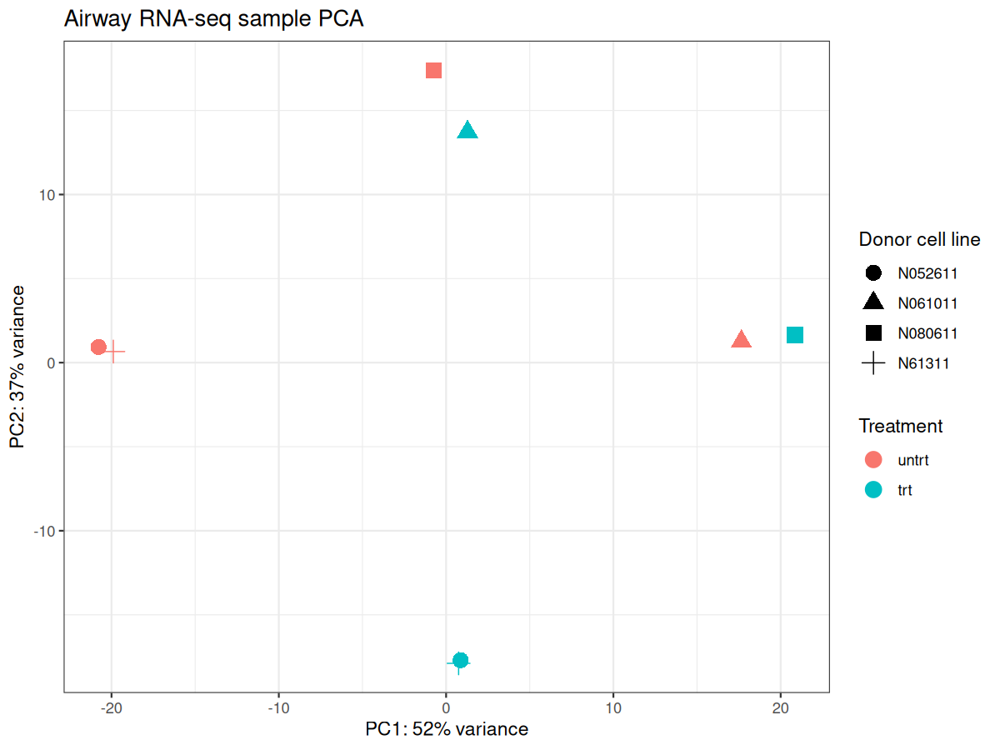
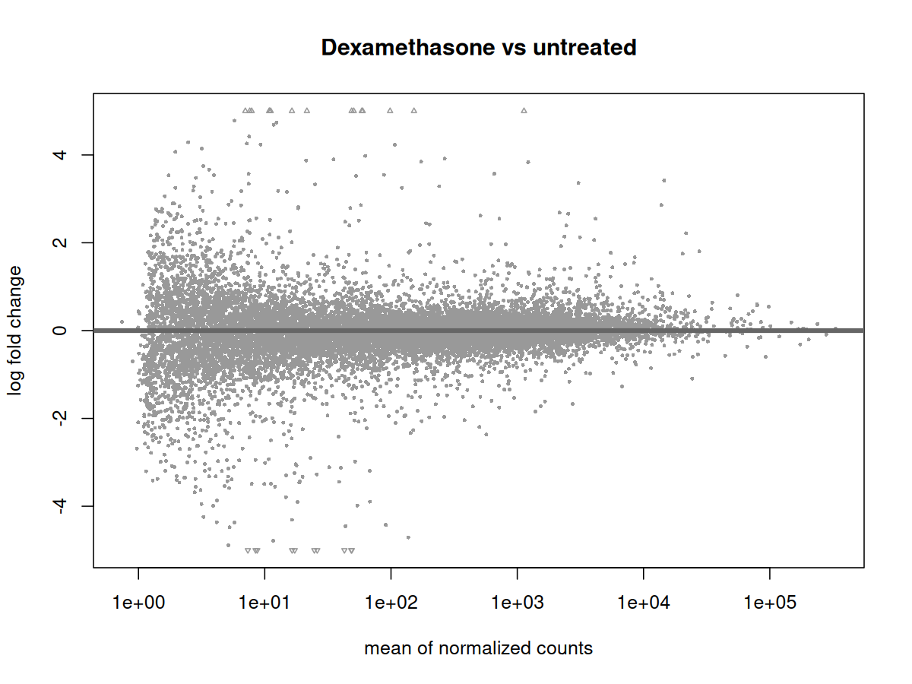
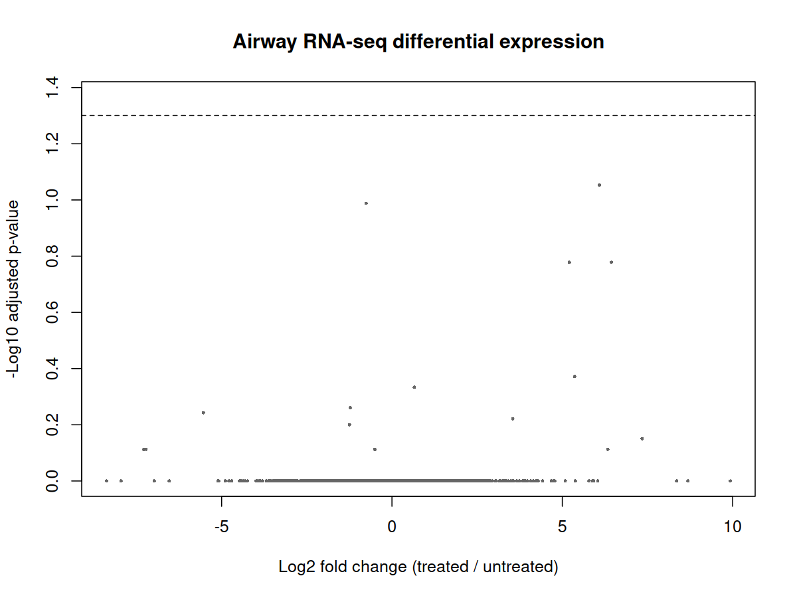

# SeqCheckFlow: Genomics QC & Workflow Toolkit

[](https://github.com/Gculb/BioSeq_Project/actions/workflows/ci.yml)
[](https://github.com/Gculb/BioSeq_Project/actions/workflows/rnaseq.yml)
[HG002 workflow (manual)](https://github.com/Gculb/BioSeq_Project/actions/workflows/hg002.yml)

**SeqCheckFlow validates and summarizes common genomics files, with separate
Nextflow workflows for RNA-seq and regional variant-calling benchmarks.** It
also provides sequence download and standalone tool helpers.

The aim is to make routine file handling and entry-level analysis more
approachable—not to replace established bioinformatics tools, automatically
analyze every file type, or claim new biological findings.

## What it does today

**[Open the project dashboard](./docs/dashboard.html)** for a visual overview
of the retained HG002 benchmark regions and the airway RNA-seq analysis.

| Entry point | Current scope |
| --- | --- |
| `seqcheckflow.pipeline` | Processes one local FASTA, FASTQ, VCF/VCF.GZ, BAM, or CRAM file and writes JSON/text validation and summary reports. |
| `seqcheckflow.download` | Searches/downloads NCBI sequence records and SRA FASTQ; downloads VCF/BAM/CRAM from direct URLs. |
| Standalone helpers | Optional alignment (BWA/minimap2), samtools operations, and remote NCBI BLAST. These are separate calls, not automatically chained by the single-file CLI. |
| `main.nf` | Eight-library airway RNA-seq example: ENA FASTQ → fastp → Salmon, then MultiQC QC and tximport/DESeq2 in R. |
| `hg002.nf` and benchmark commands | Staged HG002 GRCh38 autosomal region workflow plus a generic user-input wrapper-versus-direct-tool benchmark. |

The CLI's reports are format-specific checks and measurements. It does **not**
trim FASTQ reads, align reads, call variants, annotate variants, or interpret
biological function. The RNA-seq and HG002 workflows are distinct examples
with their own inputs and outputs; they are not generic workflows automatically
selected for arbitrary files.

## How it is organized

The single-file path detects and validates an input, runs the applicable
summary logic, then writes JSON and text reports. Download and BLAST helpers
are opt-in utilities. The two Nextflow workflows provide explicit stages for
their specific analyses and use containers to package their external tools.
The RNA-seq workflow also calls an R/DESeq2 analysis; the HG002 workflow uses
the same underlying command-line tools in separately scheduled stages.

```text
Local file ──> seqcheckflow.pipeline ──> validation + format-specific summary ──> JSON/text
NCBI/URL   ──> seqcheckflow.download ──> downloaded file (analyze separately)
Raw RNA-seq ──> main.nf ──> fastp ──> Salmon ──┬─> MultiQC
                                               └─> tximport ──> R/DESeq2
HG002 region ──> hg002.nf / benchmark ──> calls ──> GIAB truth comparison
```

See [ARCHITECTURE.md](./ARCHITECTURE.md) for component responsibilities and
workflow diagrams, and [DESIGN_NOTES.md](./DESIGN_NOTES.md) for file formats,
metric interpretation, and implementation decisions. The complete command and
dependency reference is in [the user guide](./docs/USER_GUIDE.md).

## Why these tools are used

The tools are arranged to answer different questions at each stage. The
RNA-seq workflow estimates gene-expression changes; the variant benchmark
checks whether a calling workflow reproduces a direct baseline and how both
callsets compare with a truth set. Results from one path do not substitute for
the other.

### RNA-seq analysis

| Tool or resource | Why it is used here | What it contributes—and what it cannot establish |
| --- | --- | --- |
| Nextflow | Connects downloads, per-sample processing, quantification, and the combined analysis as explicit tasks. | Tracks task inputs and outputs, schedules independent samples, and supports resuming completed work. It does not validate the biological design by itself. |
| ENA and `curl` | ENA supplies the public paired FASTQs; `curl` transfers them to task-local files with retry and resume support. | Expected byte counts, MD5 checksums, and gzip checks help detect incomplete or corrupted transfers. They do not prove that sample labels are biologically correct. |
| fastp | Trims adapter/low-quality sequence and reports read quality before and after filtering. | Provides read-level QC and processed paired reads for quantification; QC does not show that a treatment effect is present. |
| Ensembl 112 GRCh38 cDNA and annotation | Supplies the transcript reference for this run and the transcript-to-gene mapping. | Keeps quantification and gene aggregation tied to a declared reference release; results can differ with another annotation. |
| Salmon | Estimates transcript abundance from each paired library using selective alignment, mapping validation, and sequence/GC-bias corrections. | Produces per-sample transcript estimates and mapping summaries; it does not perform the treatment-level significance test. |
| tximport | Imports Salmon estimates and aggregates transcript-level abundance to gene-level counts for DESeq2. | Uses transcript-to-gene mapping and length-aware count import; it does not add biological replicates. |
| DESeq2 | Models gene counts with a negative-binomial framework and estimates the dexamethasone effect while accounting for donor cell line (`~ cell + dex`). | Reports log2 fold changes, uncertainty, and multiple-testing-adjusted p-values. Four donor pairs limit precision and power. |
| MultiQC and the sample QC summary | Combine fastp and Salmon metrics across libraries for review. | Help identify sample-level quality or mapping differences; they are QC summaries, not differential-expression evidence. |

### Variant-calling benchmark

| Tool or resource | Why it is used here | What it contributes—and what it cannot establish |
| --- | --- | --- |
| BWA-MEM | Maps paired reads to the selected reference genome. | Creates the alignments used by downstream processing and calling; mapping quality and local sequence context can affect calls. |
| samtools | Converts, sorts, indexes, and summarizes alignments; `fixmate` prepares mate fields and duplicate marking identifies likely PCR/optical duplicates. | Produces coordinate-sorted alignments and alignment QC for GATK; summary metrics do not themselves validate variant calls. |
| GATK BaseRecalibrator / ApplyBQSR | Models and applies base-quality recalibration using known variants as calibration sites. | Adjusts quality scores before calling; the known-sites file is not the benchmark truth set. |
| GATK HaplotypeCaller | Calls small variants from the processed alignments over a specified interval. | Produces a VCF for comparison; a VCF alone does not give accuracy without a suitable truth set and confident-region mask. |
| RTG `vcfeval` and GIAB truth resources | Compare each VCF with the GIAB truth callset inside the confident BED intervals. | Report scored true/false positives and false negatives and derived precision/recall/F1 for those bases only. Calls outside the confident regions are unscored. |
| Direct-tool baseline and SeqCheckFlow wrappers | Run the same configured tools and inputs through two execution paths. | Exact record parity checks wrapper behavior; it is separate from truth-set accuracy and does not prove broad or clinical validity. |

Docker packages the external runtime dependencies for these workflows, while
Nextflow manages their task graph. Together they make runs easier to repeat;
they do not replace recording exact versions, inputs, checksums, and parameters.

## Example results and limits

The examples show what the current project has exercised; they do not establish
general performance, broad biological conclusions, or clinical validity.

| Example | Observed result | What it supports—and what it does not |
| --- | --- | --- |
| HG002 chr20 pilot (historical) | The prior `chr20:10000000-11000000` report recorded 1,582 TP, 6 FP, and 6 FN for each implementation (precision, recall, and F1 0.9962); wall time was 327.71 s direct and 302.35 s wrapped. | Preserves the earlier regional benchmark and its figures. Its raw generated result directory is not present in this checkout. Do not compare its accuracy directly with chr21: the regions and scored truth variants differ; the one timing measurement is not a performance claim. |
| HG002 chr21 pilot (low-coverage interval) | On `chr21:10000000-11000000`, both runs produced identical 7,274-record VCFs. In GIAB confident bases, each had 3 TP, 13 FP, and 12 FN (precision 0.1875, recall 0.20, F1 0.1935). The BED covers 18,381 bp (1.84% of the interval). | Supports wrapper parity, not good absolute accuracy. The narrow confidence mask and 15 scored truth variants limit interpretation. One run measured 1,140.59 s vs 1,157.60 s and 592.7 vs 603.8 MiB; these are descriptive, not proven performance differences. |
| HG002 chr21 high-coverage interval | On `chr21:20000000-21000000`, both runs produced identical 2,706-record VCFs; both scored 2,392 TP, 3 FP, and 7 FN (precision 0.9987, recall 0.9971, F1 0.9979) across 976,775 benchmark bases. | Shows strong regional accuracy and wrapper parity for this interval. It does not generalize to all regions; one timing was 674.26 s direct vs 759.01 s wrapped. |
| Airway RNA-seq (GSE52778) | Eight raw-read libraries completed fastp and Salmon quantification; mapping rates were 92.3–93.9%. DESeq2 (`~ cell + dex`) found no genes below BH-adjusted `p < 0.05`. | Demonstrates a raw-read-to-analysis path. Four donors from one study are insufficient to interpret this as evidence of no treatment effect or to claim independent validation. |

The HG002 run is a regional, two-thread pilot—not whole-genome or cohort
validation. The RNA-seq example is an exploratory reanalysis of one public
study—not a new biological discovery. See
[historical HG002 chr20 results](./docs/images/hg002-accuracy-parity-chr20.svg),
[current HG002 chr21 results](./docs/images/hg002-accuracy-parity.svg),
[chr21 results by region](./docs/images/hg002-chr21-region-accuracy.svg),
[RNA-seq QC](./docs/reports/airway-multiqc.html), and the
[analysis report](./PIPELINE_ANALYSIS.md) for plots, methods, and caveats.
The report also links the primary RNA-seq publication and GIAB benchmark
reference, and explains which published findings our current results do—and do
not—reproduce. The RNA-seq workflow reruns our modern reanalysis; the original
paper's legacy computational environment and wet-lab analyses are not included.

### RNA-seq plots

These figures come from the eight-sample raw-read analysis:







## Quick start: inspect a local file

The recommended run path uses Docker Compose so the analysis dependencies come
from the repository's pinned container instead of the host Python environment.
Install Docker Desktop (or Docker Engine with the Compose plugin), start it, and
install Python 3.10 or newer. Keep the input under this project directory so
the container can access it.

```bash
python scripts/seqcheckflow.py analyze data/examples/example.fasta
```

The first run builds the container; later runs reuse it. The command writes
JSON and text reports to `results/` by default. Substitute a `.fastq`, `.vcf`,
`.vcf.gz`, `.bam`, or `.cram` file to summarize another supported format.
CRAM may require a matching reference:

```bash
python scripts/seqcheckflow.py analyze data/alignments/sample.cram \
  --reference data/references/reference.fasta
```

Downloading is a separate step. The container includes the NCBI SRA Toolkit for
SRA FASTQ downloads:

```bash
python scripts/seqcheckflow.py download fastq SRR123456 --threads 4
```

The launcher also provides `prepare-hg002` and the generic `benchmark`
command (`compare-hg002` remains an alias). The full command reference,
outputs, optional tools, and workflow prerequisites are documented in
[the user guide](./docs/USER_GUIDE.md).

## Run the example workflows

The HG002 data-preparation code accepts GRCh38 autosomes chr1–chr22. In this
checkout, end-to-end benchmark results are documented only for chr20 and two
chr21 intervals; the other autosomes are supported inputs, not validated runs.
The generic `benchmark` command is designed for supplied compatible resources
from another organism, but cross-species operation has not been demonstrated
here. See [the user guide](./docs/USER_GUIDE.md) for the tested intervals, a
chr21 example, and the custom-resource command pattern.

The Nextflow examples are optional, resource-intensive runs and require Java
17, Nextflow 24.10.5, Docker, and a Linux environment (WSL2 is suitable on
Windows). The Docker Compose launcher also supports the direct HG002 comparison
in PowerShell as shown below. See
[the workflow and scaling notes](./ARCHITECTURE.md) before running larger data.
An optional AWS Batch profile is documented in the [user guide](./docs/USER_GUIDE.md#aws-batch-execution-optional).

To run all eight airway libraries through GitHub Actions, open **Actions →
SeqCheckFlow RNA-seq → Run workflow**. The action saves the full results as a
downloadable artifact. To run a chromosome interval, use **Actions → SeqCheckFlow
HG002 Nextflow benchmark → Run workflow** and enter a GRCh38 interval. GitHub's
hosted runner is intended for regional examples; use a high-memory local host or
AWS Batch for a whole chromosome. People without write access can fork the
repository, enable Actions on the fork, or run the documented commands locally.

Raw-read RNA-seq:

```bash
docker build -f containers/rnaseq.Dockerfile -t seqcheckflow-rnaseq:latest .
nextflow run main.nf -profile docker \
  --samplesheet analysis/airway_samples.tsv \
  --threads 2 \
  --max_forks 1 \
  --outdir results/rnaseq_airway
```

`--threads` controls threads per fastp/Salmon task; `--max_forks` controls the
maximum number of concurrent download, trimming, and quantification tasks.
The default of 1 keeps peak resource use predictable. Increase it when the
machine has enough memory and CPU; per-sample quantification remains
independent, and the combined DESeq2 results are unchanged.

The full run downloads multiple public FASTQ files and needs additional disk
space for reads, trimmed files, and the Salmon index. It produces a MultiQC
report and DESeq2 results and plots.

See the [machine requirements table](./docs/USER_GUIDE.md#machine-requirements-by-analysis)
for practical starting and recommended specs for the CLI, full RNA-seq, and
regional or whole-chromosome HG002 runs. The RNA-seq and whole-chromosome sizes
are conservative estimates, not validated minimums. In particular, the current
GitHub-hosted runner has less disk than the estimated local requirement for a
full RNA-seq run.

This is the complete eight-library GSE52778 dataset in the checked-in sample
sheet; it is not downsampled. The GitHub Actions run can be tuned to two or four
threads per fastp/Salmon task and one or two concurrent analysis tasks. To resume
completed local tasks after an interruption, add `-resume` to the same Nextflow
command and keep the output path and `work/` directory.

### Reproduce the HG002 benchmark results

Run from the repository root in PowerShell with Docker Desktop running. The
prepared inputs are large and ignored by Git, so prepare them only if they are
not already present. Preparation writes to a new directory and will not
overwrite existing data.

```powershell
$prepared = "data/benchmark/giab_hg002_chr20"
if (-not (Test-Path $prepared)) {
  $prepared = "data/benchmark/giab_hg002_chr20_rerun"
  python scripts/seqcheckflow.py prepare-hg002 `
    --interval chr20:10000000-11000000 `
    --threads 2 `
    --output-dir $prepared
}
```

Run the direct-tool and SeqCheckFlow-wrapper workflows and compare both call sets to
the GIAB truth set. Each comparison needs a new output directory:

```powershell
$outdir = "results/HG002_chr20_comparison_rerun"
python scripts/seqcheckflow.py compare-hg002 `
  --read1 "$prepared/HG002_R1.fastq" `
  --read2 "$prepared/HG002_R2.fastq" `
  --reference-fasta "$prepared/chr20.fa" `
  --known-sites-vcf "$prepared/Mills.hg38.region.vcf.gz" `
  --reference-sdf "$prepared/chr20.sdf" `
  --truth-vcf "$prepared/HG002.truth.region.vcf.gz" `
  --confident-regions "$prepared/HG002_chr20_10000000_11000000.confident.bed" `
  --interval chr20:10000000-11000000 `
  --threads 2 `
  --output-dir $outdir
```

The comparison command intentionally refuses to overwrite results. If you run
it again, change `$outdir` to a new name, such as
`results/HG002_chr20_comparison_rerun2`.

#### Whole-chromosome runs

The HG002 Nextflow workflow accepts a single GRCh38 autosomal interval per run.
For example, to run all of chromosome 21 on a suitably provisioned Linux/WSL2
machine, use its full length (`46,709,983` bases):

```bash
nextflow run hg002.nf -profile docker \
  --interval chr21:1-46709983 \
  --threads 8 \
  --outdir results/HG002_chr21_full
```

The workflow fetches the regional reads and matching reference/truth resources,
then aligns, recalibrates, calls, and scores variants across that interval. It
does not currently scatter a whole chromosome into subinterval tasks or combine
all chromosomes into one workflow. To run all autosomes, repeat one full-
chromosome run per contig, using the lengths in the UCSC GRCh38 chromosome sizes
file. Whole-chromosome runs can require substantial task-local scratch space,
memory, and wall time; the 1 Mb examples are the only retained end-to-end
validation. Do not run the full-autosome loop on a standard GitHub-hosted runner.

To run the separate stage-by-stage Nextflow DAG instead (it runs direct tools
and truth-scoring, but does not produce the wrapper-versus-direct comparison
table above), use Linux/WSL2 with Java 17, Nextflow 24.10.5, and Docker:

```bash
docker build -f containers/Dockerfile -t seqcheckflow:latest .
nextflow run hg002.nf -profile docker \
  --prepared-dir data/benchmark/giab_hg002_chr20 \
  --interval chr20:10000000-11000000 \
  --threads 2 \
  --outdir results/HG002_nextflow_rerun
```

## Reproducibility and execution status

GitHub Actions runs the Python CLI tests and checks the RNA-seq image, R
smoke-test, and Nextflow preview on pushes and pull requests. The complete
raw-read RNA-seq and HG002 runs are manual because they download large public
datasets and consume more compute. A passing preview or synthetic R smoke-test
does not mean that a full hosted analysis ran; full-run outputs are produced
only when the corresponding workflow is explicitly dispatched.

The included results are small demonstrations: the HG002 pilot uses one
region, while the RNA-seq analysis uses eight libraries from four donors.
Whole-genome or multi-sample scaling would require larger compute and storage,
interval scatter/gather, and cohort-aware calling steps that are outside the
current pilot scope.
